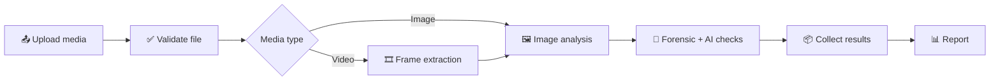

<div align="center">

# 🔍 ForensiX

### AI-Powered Digital Image & Video Forensics

*A multi-layered approach to deepfake detection and media authenticity analysis*


</div>

> [!IMPORTANT]
> ForensiX is an **analysis-support tool**. Its findings are **indicators, not definitive proof** that media is genuine or fake.

---

## 📑 Table of Contents

- [What Is ForensiX?](#-what-is-forensix)
- [Why This Project](#-why-this-project)
- [How It Works](#-how-it-works)
- [Analysis Layers](#-analysis-layers)
- [Image & Video Analysis](#-image--video-analysis)
- [Detection Model](#-detection-model)
- [C2PA vs. AI Detection](#-c2pa-vs-ai-detection)
- [External Services](#-external-services)
- [Project Structure](#-project-structure)
- [Installation](#-installation)
- [Configuration](#-configuration)
- [Limitations](#-limitations)
- [Roadmap](#-roadmap)
- [Intended Use & Ethics](#-intended-use--ethics)
- [Author](#-author)

---

## 🧭 What Is ForensiX?

Someone sends you a photo or video. Was it edited? Was it generated by AI?
Checking by hand is slow and unreliable. ForensiX brings several kinds of media checks into **one workflow** and shows the results in a single report.

```
 Upload media  ──►  ForensiX analyzes it  ──►  Findings to guide your investigation
```

Instead of trusting one detector, ForensiX collects evidence from multiple layers (metadata, visual analysis, AI models, provenance and external services) so you can reason about the media with more context.

---

## 🎯 Why This Project

AI-generated images and manipulated videos make it hard to know what to trust. Common problems:

| Problem | Why it matters |
|---|---|
| Manipulated images | Hard to spot by eye |
| AI-altered videos | Changes can hide in individual frames |
| Misleading media on social platforms | Spreads faster than it can be verified |
| Missing or stripped metadata | Limits what can be examined |
| Conflicting tool outputs | Difficult to interpret together |

**Goal:** organise these checks into one understandable workflow and encourage evidence-based conclusions rather than relying on a single score.

---

## ⚙️ How It Works



1. **Upload:** the user selects an image or video in the frontend.
2. **Validation:** the backend checks the file can be processed. Unsupported or corrupted files stop the analysis.
3. **Routing:** images go through image analysis. Videos have selected frames extracted and analysed.
4. **Analysis:** metadata, visual analysis, AI detection and configured external services each examine the media.
5. **Collection:** results from completed checks are gathered. A failed or unavailable service is reported as a failure, **not** as a negative detection.
6. **Report:** the frontend presents the findings for further investigation.

---

## 🧱 Analysis Layers

| Layer | Purpose |
|---|---|
| 📥 **Input & validation** | Receives uploads and checks they can be processed |
| 🎬 **Media processing** | Prepares images and videos (frame extraction for video) |
| 🏷️ **Metadata analysis** | Examines available file metadata |
| 👁️ **Visual analysis** | Facial and visual feature analysis |
| 🤖 **AI detection** | Model-based indicators of AI generation or manipulation |
| 🔐 **Provenance verification** | C2PA Content Credentials checks |
| 📊 **Results & reporting** | Organises findings from the completed checks |

---

## 🖼️ Image & Video Analysis

**Images** can go through validation, metadata extraction, visual/facial analysis, AI-based detection, provenance checks and result presentation.

**Videos** follow a frame-based workflow: validate → process → extract selected frames → analyse frames → collect findings → present results.

> [!NOTE]
> A frame-level result is **not** a conclusion about the whole video. If only selected frames are examined, manipulation elsewhere can go undetected.
> Missing metadata or missing provenance credentials do **not** mean media is fake.

---

## 🧠 Detection Model

ForensiX uses **CommunityForensics DeepfakeDet-ViT**, a Vision Transformer (ViT-Small) trained on 2.7M samples across 4,803 generators for detecting AI-generated images.

| | |
|---|---|
| **Paper** | [Community Forensics: Using Thousands of Generators to Train Fake Image Detectors](https://huggingface.co/papers/2411.04125) (CVPR 2025) |
| **Base model** | `timm/vit_small_patch16_384.augreg_in21k_ft_in1k` |
| **License** | MIT |

Model weights are **not stored in this repository**. Download them with:

```bash
python get_model.py
```

Model outputs can be wrong. They can produce false positives and false negatives, vary with compression and image quality, and a model score is **not** a calibrated probability.

---

## 🔐 C2PA vs. AI Detection

These answer two different questions:

| | **AI Detection** | **C2PA Verification** |
|---|---|---|
| Asks | *Does this look AI-generated or manipulated?* | *Does it carry verifiable origin and edit history?* |
| Based on | Learned patterns in the media | Signed Content Credentials |
| If negative | Not proof of authenticity | Missing credentials ≠ fake |
| If positive | Not proof of manipulation | Valid credentials ≠ every claim is true |

---

## 🌐 External Services

Optional services that `second_opinion.py` can use when the matching credentials are configured:

| Service | Role |
|---|---|
| **Reality Defender** | Deepfake detection API |
| **Sightengine** | Image and video analysis API |
| **VirusTotal** | File reputation and malware checks (**not** a deepfake detector) |

Each is optional. A missing key means that check is skipped, and the report says so. Availability also depends on network access and service usage limits.

---

## 📁 Project Structure

<!-- VERIFY: descriptions are inferred from file names. Edit any that are inaccurate. -->

```
ForensiX/
├── app.py                 # Application entry point
├── forensics.py           # Core forensic analysis
├── mlclassifier.py        # ML-based classification
├── mediapipe_face.py      # Face analysis (MediaPipe)
├── get_facemesh.py        # Face-mesh asset setup
├── c2pa_verify.py         # C2PA provenance verification
├── second_opinion.py      # External API checks (optional)
├── explain.py             # Result explanation
├── video.py               # Video processing
├── evaluate.py            # Image evaluation
├── evaluate_video.py      # Video evaluation
├── compare_models.py      # Model comparison
├── get_model.py           # Downloads the detection model
├── install.sh             # Setup helper
├── DATASET_GUIDE.txt      # Notes on datasets
├── .env.example           # Environment variable template
└── models/                # Model files (downloaded, not committed)
```

---

## 🚀 Installation

**Prerequisites:** a Python version compatible with the project's dependencies, and internet access for packages and online services.

```bash
# 1. Clone
git clone https://github.com/gourav001-s/ForensiX.git
cd ForensiX

# 2. Create and activate a virtual environment
python -m venv .venv
# Windows (PowerShell):  .venv\Scripts\Activate.ps1
# Linux / macOS:         source .venv/bin/activate

# 3. Install dependencies
pip install -r requirements.txt          # <!-- VERIFY: file names -->

# 4. Download the detection model
python get_model.py
```

**Run the app:**

```bash
python app.py                            # <!-- VERIFY: launch command -->
```

---

## 🔑 Configuration

Copy the template and fill in only the services you want to enable:

```bash
cp .env.example .env                     # Windows: copy .env.example .env
```

| Variable | Service |
|---|---|
| `REALITY_DEFENDER_API_KEY` | Reality Defender |
| `SIGHTENGINE_API_USER` | Sightengine |
| `SIGHTENGINE_API_SECRET` | Sightengine |
| `VIRUSTOTAL_API_KEY` | VirusTotal |

> [!WARNING]
> Never commit `.env`, API keys, access tokens or sensitive evidence. `.env` is already listed in `.gitignore`.

---

## ⚠️ Limitations

- AI-based detection is **not** perfectly reliable.
- Genuine media can be flagged, and manipulated media can slip through.
- Compression, image quality and the manipulation technique affect results.
- Missing metadata limits the available forensic context.
- Frame-based video analysis can miss changes in unexamined frames.
- External services may be unavailable or need credentials.
- Different methods can disagree.
- Authenticity conclusions may need original files, corroborating evidence and qualified forensic examination.

ForensiX supports an investigation. It does not replace professional forensic judgment.

---

## 🛣️ Roadmap

- [ ] Evaluate models on diverse, properly labelled datasets
- [ ] Report precision, recall and other metrics from reproducible tests
- [ ] Temporal and frame-level video analysis
- [ ] Stronger explainability for individual results
- [ ] Improved report generation and evidence documentation
- [ ] Hardened upload security and sensitive-file handling
- [ ] Robustness testing against compression and resizing

*These are planned improvements, not claims of existing features.*

---

## ⚖️ Intended Use & Ethics

ForensiX is intended for **learning, cybersecurity research, digital-media analysis and preliminary forensic examination**.

- Interpret results carefully and corroborate them with other evidence.
- Follow applicable laws and obtain proper authorization before analysing media.
- Protect sensitive media and the people shown in it.

---

## 👤 Author

**Gourav Shrivastava**
B.Tech, Cyber Security, Sagar Institute of Research and Technology (SIRT), Bhopal
Internship: State Cyber Cell

[](https://github.com/gourav001-s)

---

<div align="center">

*ForensiX aims to make digital media analysis more organised and understandable, while staying honest about the limits of automated authenticity detection.*

</div>
